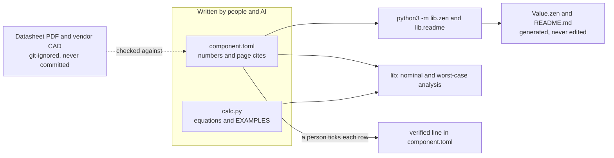

# Component library: datasheet numbers, equations, KiCad

[](https://github.com/kb1lqc/AgentEDA-Parts/actions/workflows/verify.yml) [](https://github.com/kb1lqc/AgentEDA-Parts/tags)

Each part is data (`component.toml`), datasheet math (`calc.py`), KiCad files, and a generated Zener wrapper for
the `pcb` circuit tool. Every number has a page cite. One rule decides who checks it: **a person checks what a
machine cannot.**

| Class | What | Checked by |
|---|---|---|
| Derived | Catalog values decoded from a manufacturer part number and export (MLCC `catalog.csv`) | A script, in `tools/verify.py` (`docs/spec/capacitor.md` "Export check"). No tick. |
| Human | Anything read from a datasheet table, figure or equation: absolute maximums, thermal limits, package and land rows, the pinout, every value a calculation uses | A person, on the page image. One tick per row. |
| Reference | Everything else (test limits, assembly, mass) | Nobody. Shown, never used by an analysis. |



## Use a part

```python
from lib import load, Param, wca, table

ina = load("TexasInstruments/INA821IDGK")
rg = Param.tol(2.61, 0.001, "kohm")                                      # design choice
g = wca(ina.calc.gain, rg=rg)                                             # worst case over all min/max corners
vos = wca(ina.calc.vos_rti, unit="V", g=20.0, **ina.inputs("vos_rti"))
print(table([("Gain", g, ""), ("Offset (RTI)", vos, "full temperature")]))
```

`typ` is the function at every typ input. `min` and `max` are the lowest and highest results over all 2^n
combinations of input min and max. A missing bound is an error, never a guess.

Is a part safe to use? `python3 tools/status.py <Value>` (add `--json` for a script): released, or the rows still
needing a check. Using a part needs no PDFs and no manufacturer export; those are for people who check numbers.
Each part's README is its reference: every value with its cite, conditions and notes. Worked designs live in a blocks repo ([docs/spec/blocks.md](docs/spec/blocks.md)). Use only values from `component.toml` (through `part.param(key)` or `part.inputs(fn)`);
if a number you need is missing, say so rather than estimating it.

## Check a part (human)

Every human-class row (table above) is checked by a person against the datasheet page image before it counts. Derived
rows need no tick. A review PR contains only stamps. Full steps:
[CONTRIBUTING.md](CONTRIBUTING.md#verify-parameters-the-human-check).

```sh
python3 tools/review.py INA229AIDGS                     # check one part
python3 tools/review.py --list-blocks                    # circuit blocks you can check
python3 tools/review.py --block INA229HighSideMonitor    # only the rows that block reads
```

- Run it in your own terminal. The page lists each row with its datasheet crop and one tick box.
- Tick a row only when it matches the page. Wrong: fix the TOML, run `python3 tools/verify.py --regen`. Unclear: leave it unticked and open an issue.
- `--block` and `--list-blocks` read a blocks repo (AgentEDA-Blocks, or your own): pass `--blocks-repo <path>` or set `CIRCUIT_BLOCKS`. The one file read from it is described in [docs/spec/blocks.md](docs/spec/blocks.md).

## Parts

Generated from each part's TOML by `python3 -m lib.readme`. The list is not here because it grows with the library:
it is [docs/PARTS.md](docs/PARTS.md), one section per manufacturer. "Status" counts the rows that matter that a person
has checked (see the [glossary](CONTRIBUTING.md#glossary)).

<!-- review-status:start -->
34 parts from 7 manufacturers, 7 released (every row that matters checked by a person). One line per part, by manufacturer: [docs/PARTS.md](docs/PARTS.md). Is a part safe to use: `python3 tools/status.py <Value>`.
<!-- review-status:end -->

## Python environment

Equation hashes and stamps (`docs/spec/equations.md`) need exactly Python 3.12, the version CI uses. Other tools
accept 3.11+, but on any other version equation states read `UNKNOWN` and `tools/equations.py stamp` refuses.
A virtual environment keeps this separate from the system Python:

```
python3.12 -m venv .venv
source .venv/bin/activate        # Linux and macOS
.venv\Scripts\activate           # Windows (cmd or PowerShell)
python -m pip install matplotlib
python --version                 # must print Python 3.12.x
```

Alternatives (not run here): `uv venv --python 3.12`, or `conda create -n agenteda python=3.12 matplotlib`.
Run every `python3 tools/...` command from the activated environment.

## Use in a Zener module

```zen
INA = Module("github.com/kb1lqc/AgentEDA-Parts/components/TexasInstruments/INA821IDGK/INA821IDGK.zen")
INA(name="U1", VS_P=Power("V15", voltage="15V 5%"), VS_N=Power("VN15", voltage="-15V 5%"),
    IN_P=Net("SNS_P", voltage="0V to 130mV"), IN_N=Net("SNS_N", voltage="0V"), RG1=Net("RG1"), RG2=Net("RG2"),
    REF=Net("REF", voltage="0V"), OUT=Net("VOUT"), ambient=ambient, derate=derate)
```

Run `pcb sync`. Every checked net needs a declared voltage range, or the build reports UNVERIFIED. Each part's README
lists which of its rows the wrapper checks ("Zener checks").

## Check

```sh
python3 tools/verify.py            # after every change: builds the parts you changed and runs every check
python3 tools/verify.py --all      # every part (what CI runs)
```

`verify.py` runs `lib.check`, `lib.zen`, `lib.readme`, the datasheet review check, `pcb build -Wstyle -Dwarnings` on each
part, and the unit tests. It prints one PASS line, or the first five failures and a log path.

## Contribute

- Add a part, check a part, release: [CONTRIBUTING.md](CONTRIBUTING.md)
- Data and equation format: [docs/SPEC.md](docs/SPEC.md). KiCad rules: [docs/KICAD.md](docs/KICAD.md).
- Datasheet numbers are checked by a person against the page image. Agents never stamp a row.
